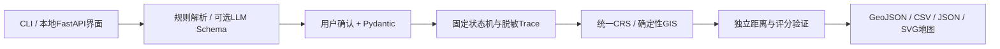

# GeoSite Agent v2

面向公共服务设施选址的可解释辅助决策原型：自然语言 → 参数确认 → 确定性 GIS → Top-K 与评分依据 → 地图和导出。

本轮全部验证基于合成数据。离线模式是保守规则语法，不是大模型；真实模型适配器只有模拟传输测试，没有调用收费 API。不是规划审批系统。

## 快速开始（Windows PowerShell）

在仓库根目录执行（Python 3.11+；本机实测3.13.13）：

```powershell
python -m venv .venv
.venv/Scripts/python -m pip install -r requirements-lock.txt
.venv/Scripts/python -m pip install --no-deps --no-build-isolation -e .
.venv/Scripts/python -m geosite --confirm
```

最后一条是最短离线 Demo。默认提示词、距离和权重是演示参数，`--confirm`表示预确认；不带该参数只解析。支持 `--help`、`--prompt`、`--request <用户指定的JSON文件>` 和 `--output`。无需密钥或原仓库数据。输出 `outputs/<run_id>/` 内的 map.html、map.geojson、ranking.csv、candidates.json、report.md、result.json 和 trace.json。

```powershell
.venv/Scripts/python -m uvicorn main_web:app --host 127.0.0.1 --port 8765
```

访问 http://127.0.0.1:8765 ：输入需求 → 解析 → 检查/编辑 JSON → 勾选确认 → 执行。可在偏好列表中同时设置 major_road 与 hospital 的权重，再执行比较排名。界面为最小开发者演示，参数编辑仍是JSON；阶段轨迹在完成后显示，未实现实时流式进度。

## 三个示例

```powershell
.venv/Scripts/python -m geosite --confirm --prompt "距医院不超过500米"
.venv/Scripts/python -m geosite --confirm --prompt "距医院不超过1000米，距工业风险点至少800米"
.venv/Scripts/python -m geosite --confirm
```

第一例是设施周边的合成候选网格点，不是查询真实POI；导入真实POI尚待实现。语法支持米/公里/千米、阿拉伯距离数字、前一至前五或阿拉伯Top-K；“附近”、未知城市/图层、未消耗的条件会要求澄清。中文距离数字尚不支持，明确拒绝而不猜测。

## 真实模型模式（未实网验证）

用户自行设置当前有效服务商与支持 JSON Schema Structured Outputs 的模型。`.env.example`仅为变量清单，程序不自动加载.env。不要把密钥放进命令历史或源码。需要 `GEOSITE_API_KEY`、`GEOSITE_MODEL`；`GEOSITE_API_BASE`默认 `https://api.openai.com/v1`。设置好环境变量后：

```powershell
.venv/Scripts/python -m geosite --mode llm --allow-model-api
```

此命令向配置的服务商发送需求并可能收费，先打印待确认的结构化参数。检查后将返回的 request 保存为 JSON，再以 `--request request.json --confirm`执行。亦可显式加 `--confirm`预确认，但建议首次运行先检查参数。Web目前只提供离线模式。模型不能执行命令、提供路径、授予确认或计算评分；输出仍须通过同一Pydantic/GIS/验证链。

协议依据：[OpenAI Structured Outputs](https://developers.openai.com/api/docs/guides/structured-outputs)。不同兼容服务的Schema支持可能不同，必须实测；不声称所有模型可用。

## 验证

```powershell
.venv/Scripts/python -m pytest -q --junitxml=outputs/pytest.xml
.venv/Scripts/python -m ruff check geosite tests evals
.venv/Scripts/python -m evals.run_eval
```

实测数字见 [评测报告](docs/evaluation/REPORT.md)，阶段与未完成项见 [实施进度](docs/IMPLEMENTATION_PROGRESS.md)。已配置离线CI，但没有推送/触发远程CI，Linux运行尚未验证。requirements-lock.txt记录本机实际安装版本；pyproject.toml定义兼容范围。GIS依赖优先使用官方PyPI wheels，未提供容器。依赖弃用警告见进度文档。

## 架构与贡献边界



`app/`保留原毕业设计的Agent/ReAct、GIS工具和Prompt；包含OpenManus相关代码命名，确切上游版本和作者归属未经核验。v2位于独立`geosite/`，避免导入原有TSD二进制源码。未宣称独立研发通用Agent框架。主要新增Schema、状态机、输入边界、统一米制GIS、评分、工件验证、离线UI和评测。`main_web.py`迁移为v2入口，`/chat`保留response封装但改为先确认；原任意路径`/open-folder`已移除。旧`main.py`保留原文件，当前无法执行。

## 数据、许可和局限

合成场景由`geosite/datasets.py`生成：3km×3km矩形、2个医院点、1个风险点、1条道路；EPSG:32650仅是这个人工场景的明确坐标依据，不会替未知数据赋值。250m格网中心可能遗漏狭小可行区；“无候选”不等价于连续空间没有可行区域。候选按精确距离判定，地图圆形缓冲使用多边形近似。模型与规则仅处理需求，空间数值都由GIS产生。

原`inputdata/`与`data/`的来源、许可与敏感性未知，不自动加载，不上传，不作为真实业务证据。仓库没有LICENSE文件，原项目和上游授权未确认；保留现有源码标识，不擅自给整个仓库授予开源许可。发布前须核实OpenManus及依赖/原始数据授权。

Git历史曾含凭证特征，需要在服务商后台轮换/吊销；本轮不重写历史。6个TSD文件无法审查内部明文，不能宣称完整安全审计通过。遗留模块只做局部脱敏和关闭原始eval，未经整体正确性验证，不应接入外部输入。v2仅限本地演示，无鉴权/多用户/配额管理。后续优先完成真实模型实测、合法真实数据接入、原版恢复与严格消融。
